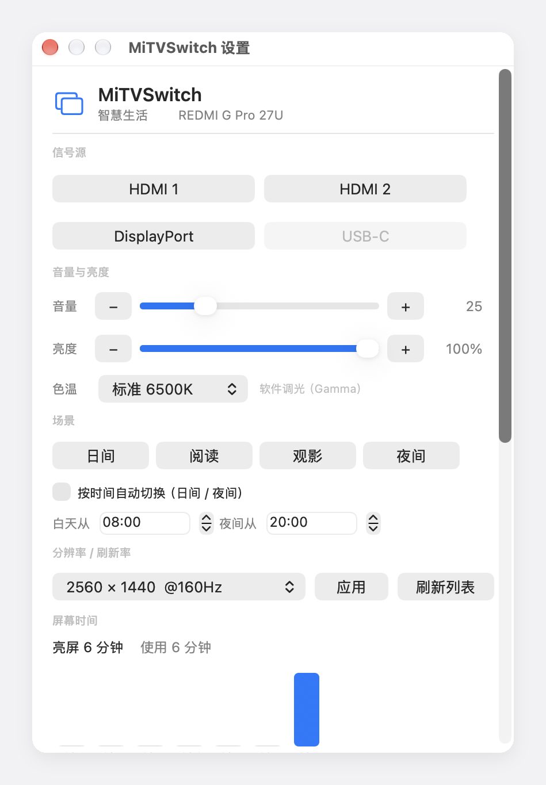

# MiTVSwitch

一个快捷键，把显示器切到游戏机；再一个快捷键，切回电脑。

不做红外、不拆机、不改接线 —— 直接走小米设备局域网里的 `6095` 接口控制信号源，顺带把音量、亮度、色温、场景、分辨率、屏幕时间都收进一个设置面板。

**macOS 菜单栏 + Windows 托盘，双平台。**

[](https://space.bilibili.com/2250922)
[](https://github.com/IceNoproblem/MiTVSwitch/releases)
[](https://github.com/IceNoproblem/MiTVSwitch/actions)
[](LICENSE)




---

## 这个项目解决什么问题

一台显示器同时接游戏机和电脑，是很常见但很难受的配置：

- 显示器自带的「自动切换信号源」判断不准，两个设备都待机时会来回跳
- 电脑休眠时显示器判定无信号进入待机，通过 HDMI-CEC 广播 System Standby，**把游戏机一起关了**
- 想手动切，得长按遥控器菜单键 → 进「信号源」→ 选中接口，三四步

所以绕开遥控器和 OSD，直接调设备的 HTTP 接口。按一个键，屏幕就跳过去 —— 而且**不需要电脑屏幕在显示中**，显示器正放着游戏机画面时照样生效。

---

## 功能

| 功能 | 依赖 | 说明 |
|---|---|---|
| 切信号源 | 6095 接口 | HDMI 1/2、DisplayPort、USB-C，按编号切换 |
| 显示器音量 | 6095 接口 | 滑动条 + `−`/`+` 按钮 |
| 亮度 | DDC/CI 或 Gamma | 能调硬件背光就调背光，不能就软件调光 |
| 色温 | 本机 | 6500K / 5000K / 4000K |
| 场景 | 本机 | 日间 / 阅读 / 观影 / 夜间，可按时间自动切换 |
| 分辨率 / 刷新率 | 系统 API | 下拉选择，即时生效 |
| 屏幕时间 | 本机 | 亮屏时长 + 使用时长，7 天柱状图 |
| 全局快捷键 | 系统 API | 全部可自定义，不需要辅助功能权限 |
| 320Hz 竞技模式 | 6095 接口 | 双模显示器 4K 160Hz ↔ 1080p 320Hz |

### 什么样的显示器能用

功能按显示器能力自动分层，**不需要任何手动配置**：

| 你的显示器 | 能用到的功能 |
|---|---|
| 小米 / 红米电视，或内置澎湃 OS 的智能显示器（6095 端口可访问） | **全部功能** |
| 普通显示器 + 支持 DDC/CI（走 DP / USB-C 更可靠） | 亮度调**硬件背光**、色温、场景、分辨率、屏幕时间；切源与音量不可用 |
| 普通显示器 + 不支持 DDC/CI（或走 HDMI） | 软件调光、色温、场景与自动切换、分辨率与刷新率、屏幕时间 |

也就是说：**不是小米的设备也能用**，少掉的只有「切信号源」和「显示器音量」这两块依赖 6095 接口的能力。

---

## 安装

### macOS

需要 **macOS 13+**。

**方式一：下载现成的**

到 [Releases](https://github.com/IceNoproblem/MiTVSwitch/releases) 下载 `MiTVSwitch-macos.zip`，解压后把 `MiTVSwitch.app` 拖进 `/Applications`。

首次打开如果被拦（未签名），右键点 App →「打开」→「打开」，或者：

```bash
xattr -dr com.apple.quarantine /Applications/MiTVSwitch.app
```

**方式二：自己编译**

需要 Xcode Command Line Tools（`xcode-select --install`）。

```bash
git clone https://github.com/IceNoproblem/MiTVSwitch.git
cd MiTVSwitch/macos
chmod +x build.sh
./build.sh
cp -R out.noindex/MiTVSwitch.app /Applications/
open /Applications/MiTVSwitch.app
```

编译不需要开发者账号，脚本用 ad-hoc 签名，本机自用够。装到 `/Applications` 是因为「开机自动启动」依赖这个位置。产物放在 `out.noindex/`：带 `.noindex` 的目录 Spotlight 不索引，免得编译出来的 App 跟 `/Applications` 里那份一起出现在启动台里，看着像装了两个。

### Windows

需要 **Windows 10 / 11 x64**。

**方式一：下载现成的**

到 [Releases](https://github.com/IceNoproblem/MiTVSwitch/releases) 下载 `MiTVSwitch-win-x64.exe`，双击运行。自包含单文件，**不需要装 .NET 运行时**。

首次运行可能弹 SmartScreen（未知发布者）：点「更多信息」→「仍要运行」。

**方式二：自己编译**

需要 [.NET 8 SDK](https://dotnet.microsoft.com/download)。

```bat
git clone https://github.com/IceNoproblem/MiTVSwitch.git
cd MiTVSwitch\windows
build.bat
```

产物在 `dist\win-x64\MiTVSwitch.exe`。

---

## 快速开始

### 第一步：找到设备的局域网 IP

任选一种：

- 路由器后台的设备列表里找名字带 `mitv-`、`MiTV`、`Redmi` 的设备
- 米家 App 里的设备详情
- 终端扫一下：macOS `arp -a | grep -i -E "mi|redmi"`，Windows `arp -a | findstr /i "mi redmi"`

### 第二步：设置地址

第一次启动会自动弹窗要地址。也可以从菜单点「**自动搜索局域网设备…**」，工具会扫本机所在网段，把找到的设备列出来（显示器会额外标注「（显示器）」）。

地址存在：

- macOS：`~/.config/mitvswitch/host`
- Windows：`%APPDATA%\MiTVSwitch\host.txt`

命令行工具读的是同一份文件。

> **macOS 会弹「允许访问本地网络」**，必须点允许，否则连不上设备。这是 macOS 14 起的本地网络权限，不是安全问题。

### 第三步：确认能通

菜单里点「**测试连接**」，会打印设备名、平台、固件版本和信号源列表。看到类似这样就成功了：

```
地址：192.168.110.155
设备：智慧生活 xxx
平台：1380    固件：16777510
信号源：HDMI1=23  HDMI2=24  DP=29
切换方式：changesource2（按编号，DP / USB-C 可用）
判定：显示器
```

---

## 设置面板

菜单里点「**打开设置面板…**」。

- **信号源**：按设备实际提供的接口列出按钮，没有的口会置灰
- **音量与亮度**：两条滑动条，两侧保留 `−` / `+` 按钮（亮度每档 5%）
- **色温**：三档下拉，右边小字实时显示亮度走的是「硬件背光」还是「软件调光」
- **场景**：四个场景一键套用，可勾选按时间自动切换并设定时间点
- **分辨率 / 刷新率**：下拉选模式 →「应用」
- **屏幕时间**：今天的亮屏 / 使用时长 + 最近 7 天柱状图
- **快捷键**：每个动作一行，点右侧按键重新录制

面板是原生控件（macOS AppKit / Windows WinForms），没有引入任何第三方 UI 框架。

---

## 快捷键

| 动作 | macOS | Windows |
|---|---|---|
| 切到 HDMI 1 | `⌃⌥1` | `Ctrl+Alt+1` |
| 切到 HDMI 2 | `⌃⌥2` | `Ctrl+Alt+2` |
| 切到 DisplayPort | 未绑定 | 未绑定 |
| 切到 USB-C | 未绑定 | 未绑定 |
| 亮度 + / − | `⌃⌥↑` / `⌃⌥↓` | `Ctrl+Alt+↑` / `Ctrl+Alt+↓` |
| 音量 + / − | `⌃⌥⇧↑` / `⌃⌥⇧↓` | `Ctrl+Alt+Shift+↑` / `Ctrl+Alt+Shift+↓` |

### 改快捷键

设置面板 → 快捷键 → 点右侧的键 → 按下新的组合键。

- 必须含 `⌃` / `⌥` / `⇧` / `⌘`（Windows 是 Ctrl / Alt / Shift / Win）至少一个，避免单个键被全局拦截
- 录制时按 `Esc` 取消，按 `Delete` 清除该动作的绑定（显示「未设置」）
- 「恢复默认快捷键」一键还原
- 改完立即重新注册，不用重启

存储位置：

- macOS：`~/Library/Preferences/top.icenoproblem.mitvswitch.plist` 里的 `hotkeyMap`
- Windows：`%APPDATA%\MiTVSwitch\hotkeys.txt`

> 如果新键和系统 / 其他软件冲突，注册会失败并记进日志，换一个组合即可。

### 为什么不需要辅助功能权限

macOS 用 Carbon 的 `RegisterEventHotKey`，Windows 用 `RegisterHotKey`。两者都是系统级注册，既不需要「辅助功能」授权，也不会抢焦点 —— 这是它比多数「模拟键盘」方案更干净的地方。

---

## 功能详解

### 切信号源

小米电视 / 小米生态显示器在 `6095` 端口跑着一个叫 **MiTV Assistant Server** 的 HTTP 服务（小米电视助手 App 用的就是它）。

| 请求 | 作用 |
|---|---|
| `GET /request?action=isalive` | 设备名、平台、固件版本 |
| `GET /controller?action=getsysteminfo` | 设备名、deviceid、MAC |
| `GET /controller?action=getsources` | **真实输入列表（编号 + 名字）** |
| `GET /controller?action=getvolume` | 当前音量 |
| `GET /controller?action=keyevent&keycode=home` | 模拟按键 |
| `GET /controller?action=changesource&source=HDMI1` | 按名字切 |
| **`GET /controller?action=changesource2&sourceid=29`** | **按编号切，DP / USB-C 只能走这条** |

返回都是 JSON，成功时是 `{"status":0,"msg":"success","data":{}}`。

#### 为什么按编号切，而不是按名字

`changesource&source=HDMI1` 这种按名字的写法对 **DP 和 USB-C 会被拒**（返回 `msg:error`），因为它只认电视那套输入名。

`getsources` 会返回设备真实的口：

```json
{"sourceList":[{"sourceId":23,"sourceName":"HDMI1"},
               {"sourceId":24,"sourceName":"HDMI2"},
               {"sourceId":29,"sourceName":"DP"}]}
```

拿编号调 `changesource2&sourceid=29` 就能切到 DP。编号沿用 MStar 电视输入表：**23 = HDMI1，24 = HDMI2，29 = DP，30 = USB-C**。老固件会把 29 报成 `DVI`，所以本项目按编号纠正名字。

程序启动时自动拉一次这份列表；`getsources` 不可用的老固件会退回按名字切，功能照旧，只是 DP / USB-C 切不动。

#### 判断你的设备支不支持

```bash
# macOS
curl -s --noproxy '*' "http://<设备IP>:6095/controller?action=getvolume"
```

```powershell
# Windows
$wc = New-Object System.Net.WebClient; $wc.Proxy = $null
$wc.DownloadString("http://<设备IP>:6095/controller?action=getvolume")
```

- 返回 `{"status":0,"msg":"success",...}` → 支持
- 连不上 → 服务没开，或者不在同一网段

### 音量

走设备的局域网遥控按键（`keyevent&keycode=volumeup`）。接口只支持 ±1，所以滑动条会按差值连发，最多 30 次。

`getvolume` 读到的是 `volume / maxVolume`，例如 `21 / 100`。

### 亮度：硬件背光优先，不行就软件调光

启动时会**只读不写**地探一次 DDC/CI：

- 读得到 → 亮度调的是**显示器硬件背光**，和显示器 OSD 里的亮度是一回事
- 读不到 → 退到**软件调光**，改显卡的 Gamma 查色表

| | 硬件背光（DDC/CI） | 软件调光（Gamma） |
|---|---|---|
| macOS | `IOAVServiceReadI2C` / `WriteI2C`，VCP `0x10` | `CGSetDisplayTransferByTable` |
| Windows | `dxva2` 的 `GetMonitorBrightness` / `SetMonitorBrightness` | `SetDeviceGammaRamp` |
| 画质影响 | 无 | 压得越暗对比度越低 |

**Apple Silicon 上 DDC/CI 只在 DP / USB-C 链路通**，HDMI 口不转发 I²C 通道，探活会失败并自动退回软件调光 —— 这不是故障。想确认自己的链路：

```bash
ioreg -lw0 -r -c IOMobileFramebuffer | grep -i transport
# {"Upstream"="DP","Downstream"="HDMI"}  ← 走 HDMI，DDC 不通
```

两条路都会在退出时恢复原始状态，唤醒后重新套用（系统有时会重置 Gamma）。

### 色温

用开尔文近似的 RGB 增益，归一化到最大通道为 1，所以只改色不改整体亮度。三档：6500K（标准）/ 5000K（暖）/ 4000K（夜间）。

### 场景与自动切换

| 场景 | 亮度 | 色温 |
|---|---|---|
| 日间 | 100% | 6500K |
| 阅读 | 85% | 5000K |
| 观影 | 70% | 4000K |
| 夜间 | 55% | 4000K |

勾上「按时间自动切换」后，程序每分钟看一次表：白天区间用「日间」，其余时间用「夜间」。区间默认 `08:00` → `20:00`，两个时间点都能改；把夜间设得比白天早也支持（按跨夜处理）。

### 分辨率与刷新率

- macOS：`CGDisplayCopyAllDisplayModes` 枚举 + `CGDisplaySetDisplayMode` 应用
- Windows：`EnumDisplaySettings` 枚举 + `ChangeDisplaySettingsEx` 应用

列表按「宽 × 高 @ 刷新率」去重，分辨率大的排前面，同分辨率下高刷在前。切换后系统要重新协商链路，黑一两秒属正常。

### 屏幕时间

每 30 秒采样一次，按天记两个数：

- **亮屏**：屏幕没睡、也没锁屏的时长
- **使用**：亮屏中，最近 5 分钟内有过键鼠 / 触控板输入的时长

| | 判空闲 | 判熄屏 / 锁屏 |
|---|---|---|
| macOS | `CGEventSource.secondsSinceLastEventType` | `CGDisplayIsAsleep` |
| Windows | `GetLastInputInfo` | `SessionSwitch` 事件 |

睡眠期间不计入。数据存 `usage.json`，保留 60 天，面板里出 7 天柱状图（柱高 = 使用时长）。

### 320Hz 竞技模式

REDMI G Pro 27U 这类双模显示器，在 4K 160Hz 与 1080p 320Hz 之间切换需要换 EDID，原本只能进显示器菜单操作。**没有对应接口**，所以走遥控按键宏：

```
menu → right × 4 → enter → right（开）/ left（关）→ back × 2
```

右移次数按实测确定为 4 次。不同机型的游戏栏层级可能不同，点不对就调 `menu` 后的右移次数（见 `setCompetitiveMode`）。

切换后显示器会黑一下再回来，系统需要几秒重新识别。

---

## 命令行

两个平台都带了不依赖 App 的命令行工具，适合写脚本或绑到其他快捷键上。

### macOS

```bash
cd macos
chmod +x mitsw

./mitsw hdmi1          # 切到 HDMI 1（hdmi2 / hdmi3 / 1 / 2 / 3 同理）
./mitsw dp             # 切到 DisplayPort（按编号，能切）
./mitsw usbc           # 切到 USB-C
./mitsw raw HDMI3      # 直接发自定义源名
./mitsw sources        # 列出设备报告的输入及编号
./mitsw id dp          # 查某个源名在设备上的编号
./mitsw status         # isalive + 信号源 + 系统信息
./mitsw vol            # 查看音量
./mitsw vol+           # 音量 +（vol- 反之）
./mitsw comp on        # 320Hz 竞技模式（off 关闭）
./mitsw keys           # 列出常用按键
```

地址优先级：`MITV_IP` 环境变量 > `~/.config/mitvswitch/host`。

### Windows

```powershell
.\switch.ps1 hdmi1
.\switch.ps1 dp
.\switch.ps1 usbc
.\switch.ps1 sources
.\switch.ps1 id dp
.\switch.ps1 status
.\switch.ps1 vol+      # 或 vup
.\switch.ps1 comp on
```

想绑成全局快捷键，可以用 AutoHotkey 包一层：

```autohotkey
^!1::Run, powershell -WindowStyle Hidden -File "C:\path\to\switch.ps1" hdmi1
^!2::Run, powershell -WindowStyle Hidden -File "C:\path\to\switch.ps1" hdmi2
```

或者给 `switch.ps1` 建个快捷方式，在「属性 → 快捷键」里设组合键。

---

## 自定义信号源

默认只列了 HDMI 1 / HDMI 2 / DisplayPort / USB-C 四个口。要改名或加口，改源码里的一张表。

**macOS** — `macos/main.swift` 顶部的 `allSources`：

```swift
let allSources: [TVSource] = [
    TVSource(key: "HDMI1", title: "游戏机",      hotkey: HotkeySpec(keyCode: UInt32(kVK_ANSI_1), mods: UInt32(controlKey | optionKey))),
    TVSource(key: "HDMI2", title: "Mac",        hotkey: HotkeySpec(keyCode: UInt32(kVK_ANSI_2), mods: UInt32(controlKey | optionKey))),
    TVSource(key: "DP",    title: "DisplayPort", hotkey: nil),
    TVSource(key: "USBC",  title: "USB-C",       hotkey: nil),
]
```

**Windows** — `windows/TrayApp.cs` 里的 `Sources`：

```csharp
internal static readonly Source[] Sources =
{
    new Source { Key = "HDMI1", Title = "游戏机" },
    new Source { Key = "HDMI2", Title = "Mac" },
    new Source { Key = "DP",    Title = "DisplayPort" },
    new Source { Key = "USBC",  Title = "USB-C" },
};
```

规则：

- `key` / `Key`：源名，**大小写不敏感**。启动时会用 `getsources` 解析成设备上的编号，再走 `changesource2`
- `title` / `Title`：菜单和面板里显示的名字
- 热键：macOS 写 `hotkey: nil` 表示不绑；Windows 的热键默认值在 `Hotkeys.Defaults()` 里，也可以直接在界面上改
- **数组第 1、2 项同时是「睡眠切换」的目标**（睡眠切到第 1 项，唤醒切回第 2 项）

> 加了自定义源名却没生效？先用 `./mitsw id <源名>` 或 `.\switch.ps1 id <源名>` 看设备认不认这个口，认不出会明确告诉你「设备没有这个输入」并列出真实可用的。

改完 macOS 重新 `./build.sh`，Windows 重新 `build.bat`。

---

## 排障

### 连不上，但 `curl` 明明能通

**最常见的坑：系统代理。**

系统代理的「忽略这些主机」列表**往往不支持 CIDR 网段** —— 写 `192.168.0.0/16` 是无效的，系统会把它当一串普通字符。结果发往 `192.168.1.x` 的请求照样被塞进代理（比如 Clash 的 `127.0.0.1:7890`），然后死在代理里。

表现很有迷惑性：**公网能通、局域网不通**，容易被误判成权限问题。

本项目的处理：

- **macOS** 不用 `NSURLSession`，改用裸 BSD socket（`socket` + `connect` + `send/recv`）自己拼 HTTP/1.0 请求，从根上绕开代理层
- **Windows** 给 `HttpClientHandler` 设 `UseProxy = false`
- 命令行版用 `curl --noproxy '*'` / `WebClient.Proxy = $null`

### 开机后第一次切换失败（macOS）

冷启动时 ARP 缓存是冷的，`connect()` 会立刻返回 `EHOSTUNREACH (65)`，看起来像设备不在线。内置了 3 次递增退避重试，通常一下就过去。

### 提示「设备没有这个输入」

程序会先读 `getsources`，所以点设备上不存在的口会直接说明：

```
设备没有提供「USBC」这个输入。
当前可用：HDMI1、HDMI2、DP
```

这通常不是 bug，而是设备真没这个口（比如 G Pro 27U 只有两个 HDMI 和一个 DP）。

确认设备到底报了什么：

```bash
./mitsw sources        # 或 .\switch.ps1 sources
```

```
信号源列表：
  HDMI1    编号 23
  HDMI2    编号 24
  DP       编号 29
```

`getsources` 取不到（老固件）时会退回按名字切，此时 `HDMI1` / `hdmi1` 都行，但 `HDMI_2` 不行（下划线不被接受），DP / USB-C 基本切不动。

> 两种失败容易混淆：`changesource` 对无效源名返回 `{"status":0,"msg":"error"}`，而 action 完全不存在时返回空 body 的 404。

### 音量键 / 亮度键没反应

- 音量走局域网遥控，**设备必须在线**；离线时按了不报错也不生效
- 亮度默认走软件调光，改的是本机 Gamma，与显示器无关；没变化就看面板里百分比是否真的动了
- Windows 上有些显卡驱动会拒绝偏离标准曲线太远的 Gamma（最暗大约只到 50%），日志里会记「显卡不接受」

### 亮度没走硬件背光

DDC/CI 是显示器调背光的标准做法，`m1ddc` / BetterDisplay / MonitorControl 都走这条。探不到就安静退回软件调光，常见原因：

- **Apple Silicon 的 HDMI 口不开放 DDC 的 I²C 通道**（最常见的那个）
- 显示器本身不支持 MCCS 亮度 —— 电视和入门显示器很普遍
- 显示器在节能状态，先唤醒再探

判断当前走哪条路：面板里色温右边那行小字，或看日志的 `DDC 探活：…`。

> 切信号源和显示器音量**不走 DDC**，它们走 6095 局域网接口，普通显示器没有这个能力。

### 为什么不用 HDMI-CEC

方向反了。CEC 是让设备之间互相通知，不是让电脑精确指定「切到第几个输入口」，而且 PC 本身不发 CEC 命令。

顺带一提：如果显示器还接着游戏机，**进显示器设置里关掉「CEC 一键关机 / 设备自动关机联动」，保留「CEC 开机联动」**，就能解决「电脑休眠把游戏机一起关掉」的问题 —— 这跟切源是两件事，建议一起处理。

---

## 已知限制

- **USB-C 只有带这个口的机型才有**，工具会如实报告「设备没有这个输入」，不是切换失败
- **320Hz 按键序列只在 REDMI G Pro 27U 上验证过**，其他双模机型的菜单层级可能不同，需调 `menu` 后的右移次数
- **DDC/CI 硬件背光在 Apple Silicon 的 HDMI 口上通不了**，会退回软件调光
- 软件调光压暗后对比度会下降，替代不了硬件背光
- 屏幕时间只统计主显示器，多屏时不做区分
- 自动场景只切日间 / 夜间两个，「阅读」「观影」需要手动点
- 不做自动更新
- `action=capturescreen`（截屏）在 HDMI 输入下无效，因为此时 TV 系统在后台
- 部分设备的 ADB(5555)、Android TV Remote(6466/6467) 是关的，本工具不依赖它们
- 小米电视助手协议是**非公开接口**，系统更新后可能变化。真改了就退回 `keyevent` 模拟按键
- Windows 版与 macOS 版逻辑一致，但尚未在大量机型上长期验证
- macOS 版是菜单栏常驻形态，没有 Dock 图标

---

## 项目结构

```
MiTVSwitch/
├── macos/
│   ├── main.swift        菜单栏 App、菜单、热键、场景与自动切换（AppKit + Carbon）
│   ├── Panel.swift       设置面板 + 快捷键录制 + 7 天柱状图
│   ├── Display.swift     分辨率切换 + DDC/CI 硬件背光（IOAVService）
│   ├── Usage.swift       屏幕时间统计
│   ├── Info.plist
│   ├── build.sh          swiftc 一键编译打包
│   └── mitsw             命令行工具
├── windows/
│   ├── Program.cs        入口 + 单实例
│   ├── TrayApp.cs        托盘图标、菜单、热键、动作分发
│   ├── PanelForm.cs      设置面板 + 快捷键录制 + 7 天柱状图
│   ├── Picture.cs        亮度 / 色温 / 场景 / 自动切换
│   ├── Ddc.cs            硬件背光（dxva2）
│   ├── Display.cs        分辨率与刷新率切换
│   ├── Usage.cs          屏幕时间统计
│   ├── Gamma.cs          软件调光 / 色温（SetDeviceGammaRamp）
│   ├── Hotkeys.cs        快捷键配置与持久化
│   ├── HotkeyWindow.cs   WM_HOTKEY / WM_POWERBROADCAST 接收窗口
│   ├── TvClient.cs       6095 接口调用 + 局域网发现 + 编号解析
│   ├── Settings.cs       配置读写 + 开机自启
│   ├── Prompt.cs         两个小对话框
│   ├── MiTVSwitch.csproj
│   ├── build.bat
│   └── switch.ps1        命令行工具
├── docs/panel.png        设置面板截图
├── NOTICE                第三方成果归属声明
└── .github/workflows/build.yml
```

### 配置文件位置

| 内容 | macOS | Windows |
|---|---|---|
| 设备地址 | `~/.config/mitvswitch/host` | `%APPDATA%\MiTVSwitch\host.txt` |
| 快捷键 | `~/Library/Preferences/top.icenoproblem.mitvswitch.plist` | `%APPDATA%\MiTVSwitch\hotkeys.txt` |
| 亮度 / 色温 / 场景 | 同上 plist | `%APPDATA%\MiTVSwitch\*.txt` |
| 屏幕时间 | `~/Library/Application Support/MiTVSwitch/usage.json` | `%APPDATA%\MiTVSwitch\usage.json` |
| 日志 | `~/Library/Logs/MiTVSwitch.log` | `%APPDATA%\MiTVSwitch\MiTVSwitch.log` |

### CI

`.github/workflows/build.yml`：

- 推到 `main` 或提 PR 时，在 `windows-latest` / `macos-latest` 上编译，产物存 artifact
- 打 `v*` 标签时自动建 Release，附 `MiTVSwitch-win-x64.exe` 和 `MiTVSwitch-macos.zip`

---

## 安全与隐私

- 只在局域网内发 HTTP GET，不联网、不上报、无遥测
- 设备端**没有鉴权**：能访问到 6095 端口的人都能控制它。**不要把 6095 端口映射到公网**
- 日志只记请求结果，不含隐私数据
- 屏幕时间数据只存在本机，不上传

---

## 致谢

- **[MonitorBar](https://github.com/Binaryify/MonitorBar)**（MIT，© 2026 binaryify）—— `getsources` / `changesource2` 这套按编号切源的接口、29/30 的输入编号约定、双模显示器切 320Hz 的按键宏，都是从它这里学到的。屏幕时间、分辨率切换、场景分区的思路也参考了它。本项目用 Swift 与 C# 重新实现，未复制其 Go 源码。
- **[MonitorControl](https://github.com/MonitorControl/MonitorControl)**（MIT）—— macOS 端 DDC/CI 的报文格式与重试策略参考了它的 `Arm64DDC.swift`。本项目只实现亮度 VCP `0x10`，并以 Swift 重写。

完整归属声明见 [NOTICE](NOTICE)。

---

## 免责声明

非官方项目，与小米公司无任何关联。使用自有设备，风险自负。所依赖的接口为非公开协议，可能随系统更新变化。

## License

**[GPL-3.0](LICENSE)**（GNU General Public License, Version 3, 29 June 2007）。

| 要求 | GPL-3.0 的规定 |
|---|---|
| **必须署名** | 分发时必须保留版权声明与作者署名；修改过的版本必须显著标注「已修改」及修改日期 |
| **必须开源** | 对外分发（含修改版、二进制版）都必须提供**完整对应源代码**，且同样以 GPL-3.0 授权，不允许改成闭源 |
| **允许商用** | GPL-3.0 **不禁止**商业使用。它约束的是「分发时是否开源」，不是你「能不能靠它赚钱」 |
| **专利授权** | 贡献者被视为向使用者授予专利许可，不能事后拿专利反过来起诉使用者 |
| **无担保** | 作者不提供任何担保，使用风险自负 |

完整条款见 [LICENSE](LICENSE)，官方原文见 [gnu.org/licenses/gpl-3.0](https://www.gnu.org/licenses/gpl-3.0.html)。
